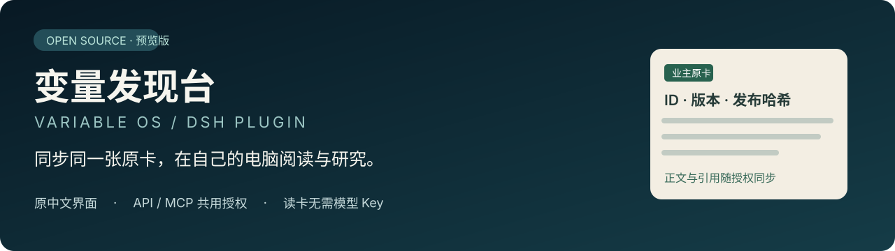
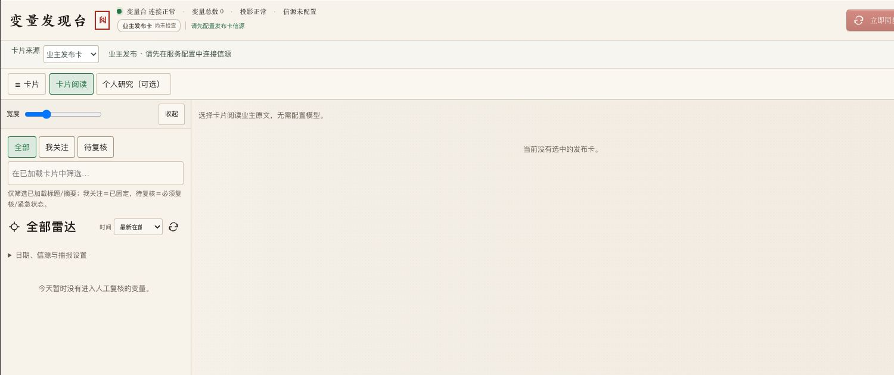
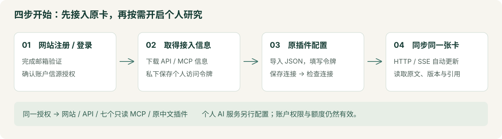
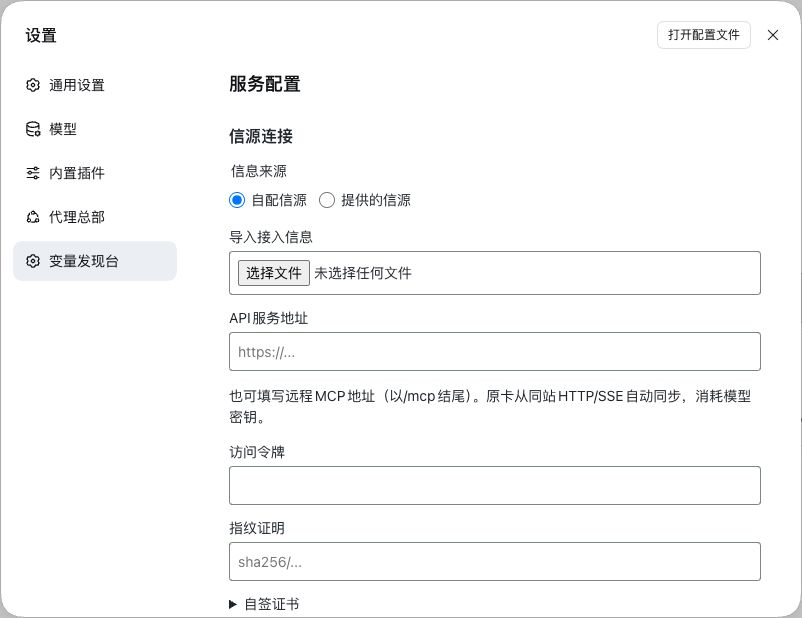

# Variable OS · 原中文 DSH 变量发现台

业主在服务端发布原卡，读者在本机原中文 DSH 插件中同步、阅读和研究。同步原卡不需要模型 Key，也不会重新生成一张相似的卡。

**当前发布：0.1.1 公开预览版。** 适合愿意反馈问题的 macOS 用户；完整产品、Windows、百人并发及所有可选 AI 能力尚未验收。此仓库发布插件源码与安装包，不包含运营方私有研究库或完整网站后台。

- [下载预览版安装包与源码包](https://github.com/ymj8903668-droid/variable-os-dsh/releases/tag/v0.1.1-preview.20261019)
- [中文安装与配置](docs/安装与配置.md)
- [源码构建与二次开发](docs/源码构建.md)
- [验收记录与已知限制](docs/验收与限制.md)
- [正式服务网站](https://ymj0418.com:18443/)

## 实际界面

上图为本次新 HOME 安装后的真实界面：信源未配置、原卡 0 张、模型 Key 未配置。用于展示布局与空状态，不代表真实卡同步或 AI 质量已经验收。

## 使用路径

| 需求 | 选择 |
| --- | --- |
| 在 Mac 安装原中文插件 | Release 中的 macOS ZIP；先准备 Node 24，安装后有独立 DSH 工具链 |
| 已有兼容的官方 DSH | Release 中的插件 TGZ；必须使用对应版本和独立 profile |
| 修改界面或本地功能 | 克隆本仓库，阅读 `plugin-source/` 与构建说明 |
| 给 MCP 客户端读取授权数据 | 网站下载远程 MCP 接入信息，或在插件中导出共用授权的本机 stdio MCP 配置 |

## 使用自己的账户接入

在网站注册并完成邮件登录，取得自己的访问令牌和接入信息文件；账户须有相应信源授权。在插件的「信源连接」导入接入信息，填写令牌，保存并检查连接。地址和证书指纹从账户页导入，不在文档里固定容易过期的指纹。

实际设置页可导入接入信息，再填写自己的令牌；截图所有凭证均为空。

API 地址和同站 `/mcp` 地址均可用作插件接入地址；自动卡片同步实际使用 HTTP/SSE。七个只读 MCP 工具共用授权，MCP 不负责生成或发布业主卡片。**仅安装客户端不会自动获得会员资格、数据权限或无限服务额度。**

原卡保留上游 ID、版本、发布哈希及证据引用。个人研究与业主原卡分开保存；修改开源客户端不能越过服务器授权。用户可以依法修改和再分发插件，数据及第三方服务的使用另受各自授权约束。

## 可选能力

本机个人成卡、IMA、模型研究、联网搜索和语音是独立配置项。它们可能需要自己的凭证、订阅及费用；未配置不妨碍授权原卡的同步查看。完整研究的效果、来源覆盖与服务可用性以实际配置和验收记录为准，不承诺与业主私有环境天然等同。

## 版本与许可

插件代码版本 `0.1.1`；Git 发布标签 `v0.1.1-preview.20261019`。官方 DSH 固定为 `0.2.1-alpha.2`，构建基线为 Node `24.19.0`、pnpm `11.25.0`，请勿用未验证的 `latest` 代替。

第一方代码沿用 [GPL-3.0-only](LICENSE)，第三方声明见 [NOTICE](NOTICE)。没有更改许可证，没有导入原私有仓库的 Git 历史。冻结源码中的历史候选说明和 `publicReleaseQualified: false` 保留；公开预览发布不等于稳定版或完整交付。当前安装及验收状态以本仓库顶层中文文档为准。
